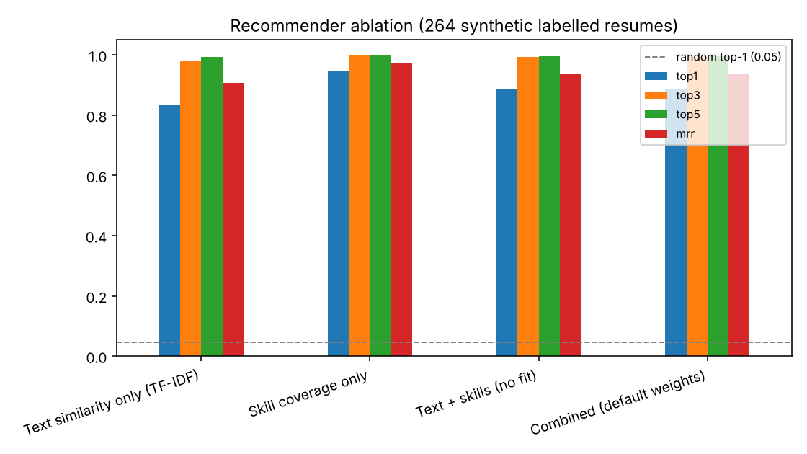
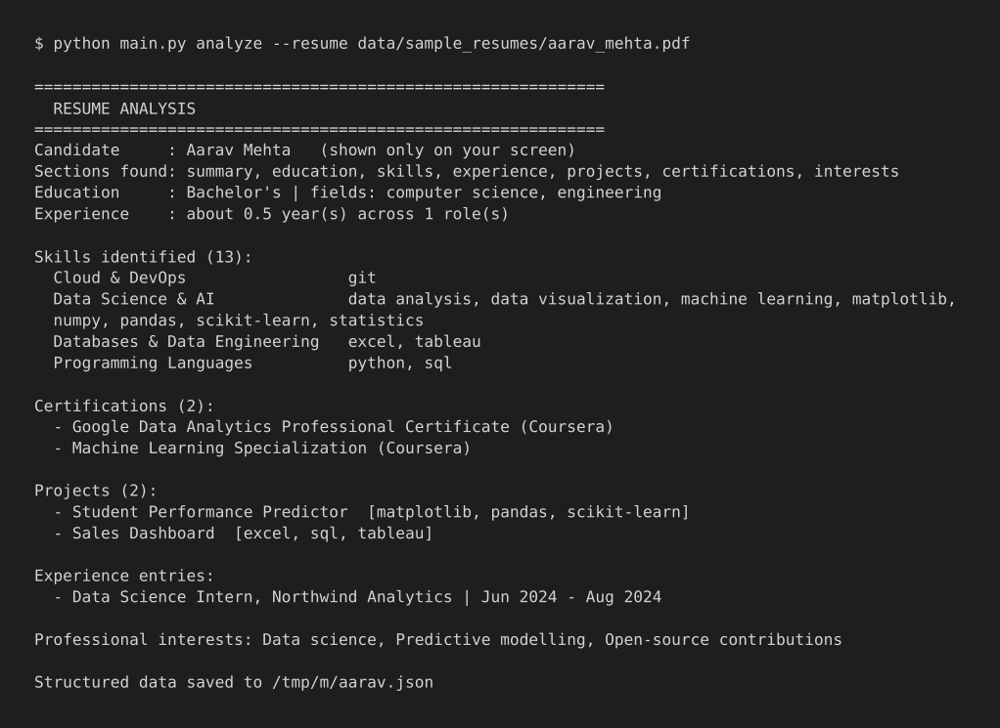
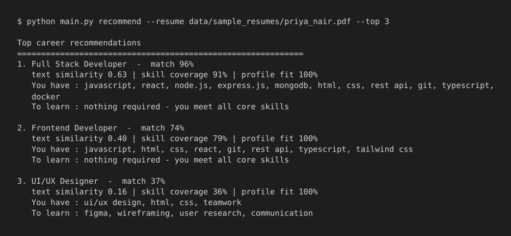
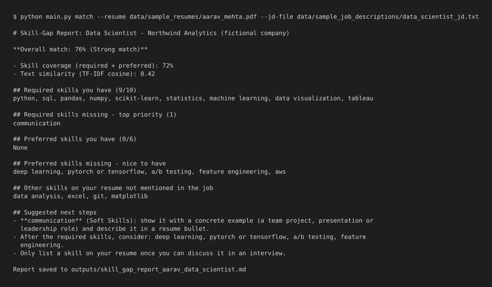
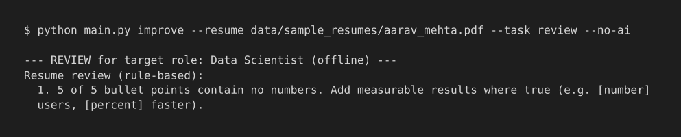
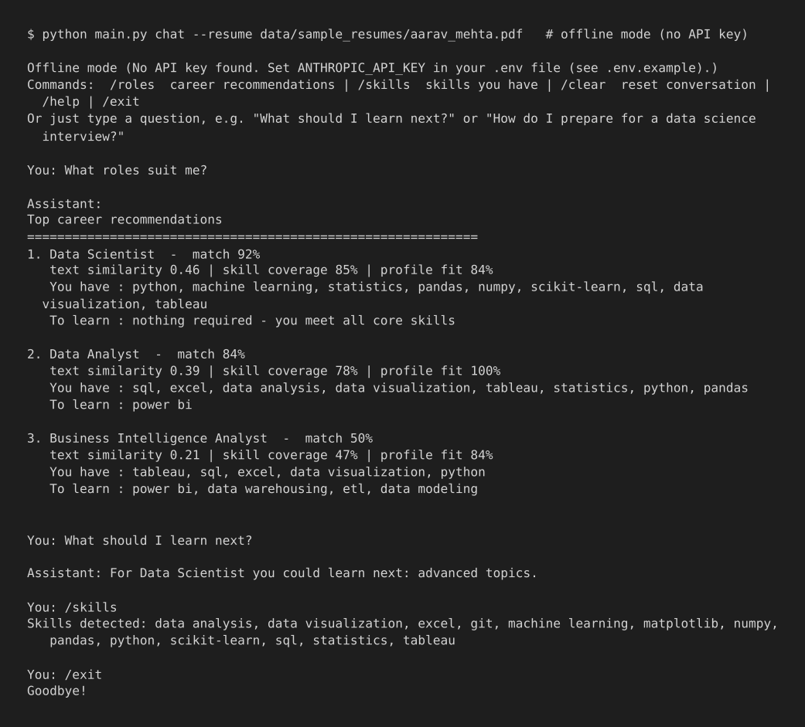
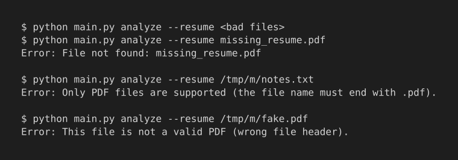

# AI-Powered Career Guidance and Resume Intelligence System

A command-line application that reads a resume PDF, extracts structured information and skills with NLP, recommends suitable career paths
(TF-IDF + cosine similarity + content-based filtering), compares the candidate with a job description (skill-gap report), and uses a
**Generative AI API** (Anthropic Claude, OpenAI or Google Gemini) to improve resume content, write summaries, suggest skills, build learning roadmaps and chat about careers.
No frontend, backend, web app, dashboard or GUI is used. Everything runs through Python scripts in the terminal.

> ⚠️ **Honest notes about this repository**
> - All sample resumes, job descriptions and the evaluation set are **fictional / synthetic** (generated by `scripts/make_data.py`). The 22 job roles were hand-written from typical job postings, not scraped from a specific dataset.
> - Evaluation numbers describe behaviour on this synthetic data, not real hiring outcomes (see [Evaluation](#evaluation)).
> - The AI features were verified with **mocked** providers; no real API call could be made while building. Capture your own real outputs before submitting (see `docs/sample_prompts_and_outputs.md`).
> - PyMuPDF is the primary PDF parser, but the build environment only had `pypdf`, so the automatic `pypdf` fallback is what was tested.

## Requirements checklist
| Requirement in the project brief | Where it is implemented |
|---|---|
| Resume PDF via terminal path, **file validation** | `src/pdf_parser.py` (extension, size, magic bytes, empty, encrypted, page limit, scanned-PDF detection) |
| Extract education, skills, certifications, projects, experience, interests | `src/resume_parser.py` (regex + section detection), `src/skill_extractor.py` |
| Text preprocessing, tokenization, keyword extraction | `src/text_processing.py` (no downloads needed; NLTK/spaCy not required) |
| Skill identification, structured information extraction | `data/skills_taxonomy.json` (140 skills, aliases), `parse_resume()` |
| Career recommendation: TF-IDF, cosine similarity, content-based filtering | `src/recommender.py`, trained model in `models/career_recommender.joblib` |
| Job-description analysis (file or terminal), matching/missing skills, similarity score, skill-gap report | `src/jd_matcher.py` |
| GenAI: resume improvement, project rewrite without inventing achievements, summaries, skills to learn, roadmaps | `src/career_assistant.py`, `src/llm_client.py` |
| Interactive multi-question chatbot using resume context | `src/chatbot.py` |
| API key management, error handling, secure handling of personal information | `src/llm_client.py`, `src/privacy.py`, `.env.example`, `.gitignore` |
| Evaluation and testing reports | `src/evaluation.py` → `docs/Evaluation_Report.md`; `tests/` (54 unit tests) |
| Dataset / sample files | `data/` |

## Project structure
```
career-guidance-resume-intelligence/
├── main.py                      # command-line interface
├── src/
│   ├── config.py                # paths, limits, score weights
│   ├── pdf_parser.py            # validation + text extraction (PyMuPDF, pypdf fallback)
│   ├── text_processing.py       # cleaning, tokenisation, stop-words, keywords
│   ├── skill_extractor.py       # taxonomy-based skill identification
│   ├── resume_parser.py         # structured information extraction
│   ├── recommender.py           # TF-IDF career recommender
│   ├── jd_matcher.py            # job-description analysis and skill-gap report
│   ├── privacy.py               # PII redaction and consent
│   ├── llm_client.py            # Anthropic / OpenAI / Gemini client with retries
│   ├── career_assistant.py      # AI tasks + offline fallbacks
│   ├── chatbot.py               # interactive chatbot
│   └── evaluation.py            # evaluation of recommender and extractor
├── data/                        # skills_taxonomy.json, job_roles.csv, sample_resumes/, sample_job_descriptions/, eval/
├── models/                      # saved TF-IDF recommendation model
├── outputs/                     # evaluation results, sample skill-gap reports
├── docs/                        # PDF report, evaluation report, prompts, screenshots
├── private/                     # put YOUR real resumes here (git-ignored)
├── scripts/make_data.py         # regenerates all sample/synthetic data
├── tests/test_project.py        # 54 unit tests (AI providers mocked)
├── requirements.txt  .env.example  .gitignore
```

## Installation
```bash
git clone https://github.com/mansoormr0507/career-guidance-resume-intelligence.git
cd career-guidance-resume-intelligence
python -m venv venv
source venv/bin/activate            # Windows: venv\Scripts\activate
pip install -r requirements.txt     # also install openai or google-genai if you use those providers
cp .env.example .env                # Windows: copy .env.example .env   -> then edit .env
```
In `.env` set `LLM_PROVIDER` (`anthropic`, `openai` or `gemini`) and the matching key. **Without a key every feature still works in offline mode**, except free-form AI answers.
Model names are defaults in `src/config.py`; if a provider retires one, set `LLM_MODEL` in `.env`.

## Usage
Five fictional sample resumes and three sample job descriptions are included.
```bash
python main.py build-model                                       # build the TF-IDF recommender (done automatically if missing)
python main.py analyze   --resume data/sample_resumes/aarav_mehta.pdf
python main.py analyze   --resume private/my_resume.pdf --json outputs/my_profile.json   # JSON has no raw text / contact info
python main.py recommend --resume data/sample_resumes/priya_nair.pdf --top 5
python main.py match     --resume data/sample_resumes/aarav_mehta.pdf --jd-file data/sample_job_descriptions/data_scientist_jd.txt --report outputs/gap.md
python main.py match     --resume private/my_resume.pdf --jd-stdin               # paste a job description, finish with END
python main.py improve   --resume data/sample_resumes/aarav_mehta.pdf --task review     # review | summary | project | skills | roadmap
python main.py improve   --resume ... --task roadmap --role "Data Scientist" --weeks 8
python main.py improve   --resume ... --task review --no-ai                     # offline rule-based only
python main.py chat      --resume data/sample_resumes/aarav_mehta.pdf
python main.py evaluate                                           # evaluation report
python -m unittest discover tests -v                              # tests
```
If `--resume` is omitted the program asks for the path in the terminal. In the chatbot type `/roles`, `/skills`, `/clear`, `/help` or `/exit`.

## How it works
1. **Validate and extract**: checks the file, then extracts text (PyMuPDF; pypdf if unavailable).
2. **NLP preprocessing**: clean text, tokenise (keeping `c++`, `node.js`, `ci/cd`), remove stop words.
3. **Information extraction**: split into sections by heading, detect degree level and field, estimate years of experience from date ranges, list certifications/projects/interests, identify skills from a 140-skill dictionary with aliases (longest match wins, so "React Native" is not also "React").
4. **Recommendation**: for each of 22 roles, `score = 0.50·text similarity + 0.40·skill coverage + 0.10·fit`.
   Text similarity is the cosine between TF-IDF vectors (1-2-grams) of the resume and the role; skill coverage counts required skills (weight 1) and preferred skills (weight 0.5); fit compares education level/field and experience with the role. Weights are in `config.py`.
5. **Job matching**: reads required vs preferred skills from a job description (understands "X or Y" alternatives and "nice to have" sections), computes the match score and writes a skill-gap report.
6. **Generative AI**: personal details are redacted, the user consents, and a guarded prompt is sent. If anything fails, an offline rule-based version is shown instead.

## Privacy, security and API-key management
- API keys come only from environment variables / `.env`; they are never in code, printed or logged. `.env` is git-ignored; only `.env.example` is committed. A unit test checks that errors never contain the key.
- Before any AI call, **name, email, phone number, links and addresses are removed** (`src/privacy.py`), the text is truncated to 6,000 characters, and the user must consent (or pass `--yes`).
- The program never writes resume text to disk or logs; exported JSON and reports contain analysis only. Keep real resumes in `private/` (git-ignored).
- The resume is placed inside `<resume>` tags and declared to be data, not instructions, to reduce prompt-injection risk from text inside a resume. This reduces but cannot eliminate the risk.
- Prompts forbid invented achievements: unknown numbers must be written as placeholders like `[add measurable result]`. Always check AI output before using it.

## Evaluation
Full details: [`docs/Evaluation_Report.md`](docs/Evaluation_Report.md). Recommender tested on 264 labelled **synthetic** resumes (22 roles, random guess = 4.5% top-1):

| Variant | Top-1 | Top-3 | Top-5 | MRR |
|---|---|---|---|---|
| Text similarity only (TF-IDF) | 0.833 | 0.981 | 0.992 | 0.907 |
| Skill coverage only | **0.947** | 1.000 | 1.000 | 0.972 |
| Text + skills (no fit) | 0.886 | 0.992 | 0.996 | 0.938 |
| **Combined (default weights)** | 0.886 | 0.992 | 0.996 | 0.938 |

The honest reading: skill coverage alone scores highest because the synthetic resumes were *generated from* the role skill lists, which favours it; the default weights were chosen in advance and **not tuned** on this data, and the fit term has no effect here because all synthetic candidates have similar education.
The most common mix-ups are between neighbouring roles (Data Analyst ↔ BI Analyst, DevOps ↔ Cloud Engineer). Skill extraction on the 5 sample PDFs scores precision/recall 1.0, but those resumes were written from the same dictionary, so this is an optimistic sanity check (details and the answer-key correction are explained in the report).



## Screenshots (terminal)
| | |
|---|---|
|  |  |
|  |  |
|  |  |

## Limitations
- Text-based PDFs only (no OCR); multi-column or heavily designed resumes can confuse section detection.
- Skill detection is dictionary-based: skills not in the taxonomy are missed and unusual wording may not match.
- Only 22 roles; the recommender uses hand-written role definitions rather than real job-posting data.
- Experience is estimated from date ranges and may be wrong for unusual formats.
- AI answers can contain mistakes; real AI output was not captured in the build environment.

## Future enhancements
Use a real job-postings dataset; add OCR for scanned resumes; learn skill embeddings (e.g. sentence transformers); add a supervised role classifier; support DOCX resumes; add interview-question practice mode.
