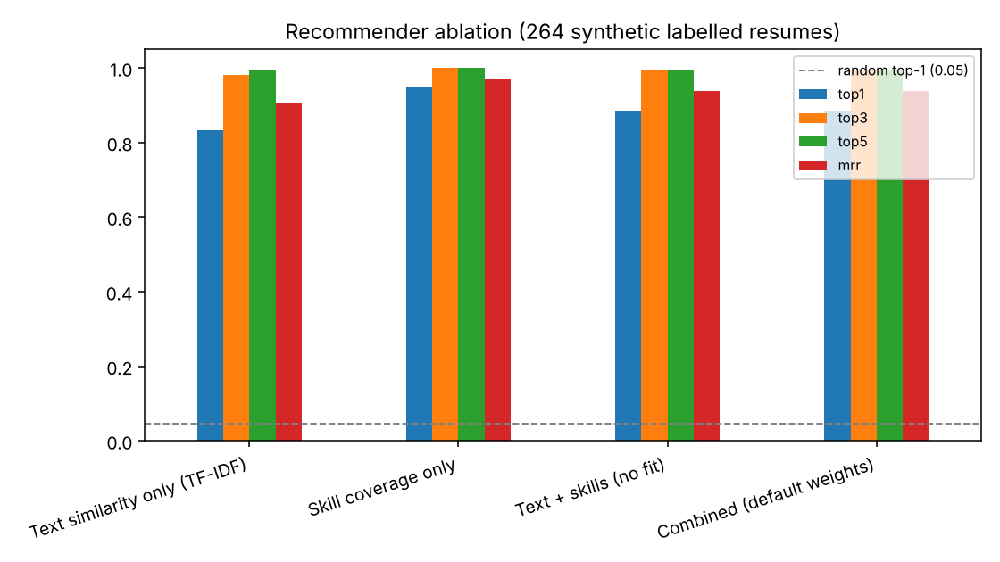
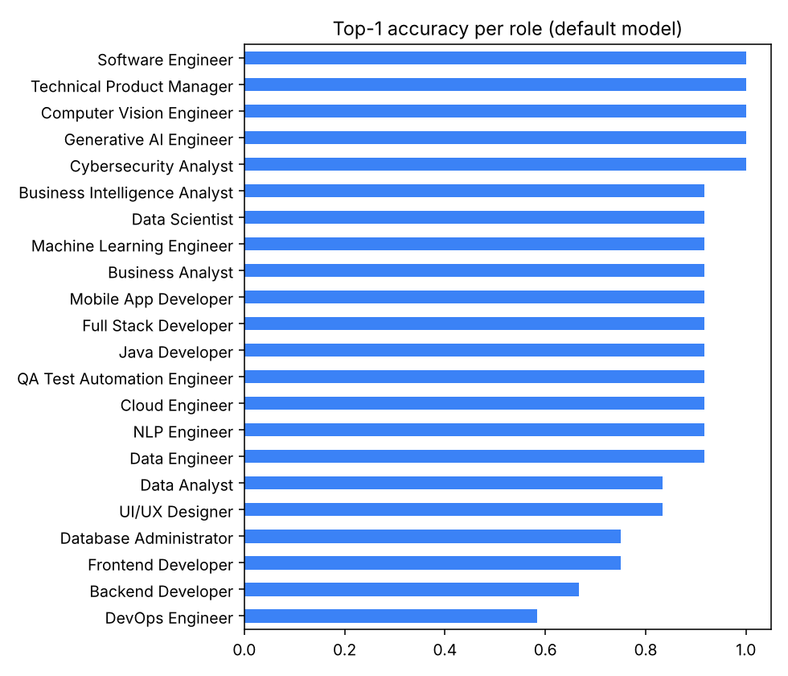

# Evaluation and Testing Report

> All evaluation data is **synthetic or fictional** (generated by `scripts/make_data.py`). The numbers show how the system behaves on this controlled data, not on real hiring outcomes.

## 1. Career recommender

264 labelled synthetic resumes (12 per role, 22 roles). Each resume contains 55-90% of its role's required skills, some preferred skills, 1-3 skills borrowed from a different (neighbouring) role and 2 random skills, using random aliases (e.g. 'sklearn'). Every resume goes through the full pipeline (text -> parsing -> ranking).

```
                                top-1   top-3   top-5     MRR
Text similarity only (TF-IDF)  0.8333  0.9811  0.9924  0.9070
Skill coverage only            0.9470  1.0000  1.0000  0.9722
Text + skills (no fit)         0.8864  0.9924  0.9962  0.9376
Combined (default weights)     0.8864  0.9924  0.9962  0.9376
```

Random guessing would give top-1 = 4.5%.

Most common mix-ups (true -> predicted):

- Data Analyst -> Business Intelligence Analyst: 2
- Backend Developer -> Generative AI Engineer: 2
- DevOps Engineer -> Cloud Engineer: 2
- Data Scientist -> Cloud Engineer: 1
- Machine Learning Engineer -> NLP Engineer: 1
- Data Engineer -> Business Intelligence Analyst: 1

**Reading the ablation honestly:** skill coverage alone scores highest here because the synthetic resumes were *generated from* each role's skill list, which favours that component. TF-IDF text similarity and the fit score add information that this benchmark cannot reward (real resumes describe skills in varied wording; all synthetic candidates have similar education, so the fit term changes nothing). The default weights were chosen in advance (config.py) and were not tuned on this benchmark; they can be changed there. Real-world validation with genuine resumes would be needed to choose weights properly.





## 2. Skill extraction

Evaluated on 5 sample resume PDFs against an answer key: precision **1.000**, recall **1.000**, F1 **1.000**.

**How to read this honestly:** the resumes were written from the same skill dictionary the extractor uses, so near-perfect scores are expected and say little about real-world resumes. The first version of the answer key listed only the skills the author intended; the extractor then reported 5 extra skills (precision 0.926, recall 1.000). Reading the PDFs showed that all 5 were genuine mentions (a certificate title, an interest, a project bullet), so the key was corrected. That correction was made after seeing the extractor's output, so treat the final numbers as optimistic. The unit tests contain harder, hand-written cases (c++, c#, node.js, 'react native' vs 'react', words such as 'go' and 'express' that must NOT match).


## 3. Automated tests

`python -m unittest discover tests -v` runs the unit tests (PDF validation, parsing, skill extraction, recommender, JD matching, privacy redaction, LLM error handling with mocked providers). See `docs/screenshots/` for a run.